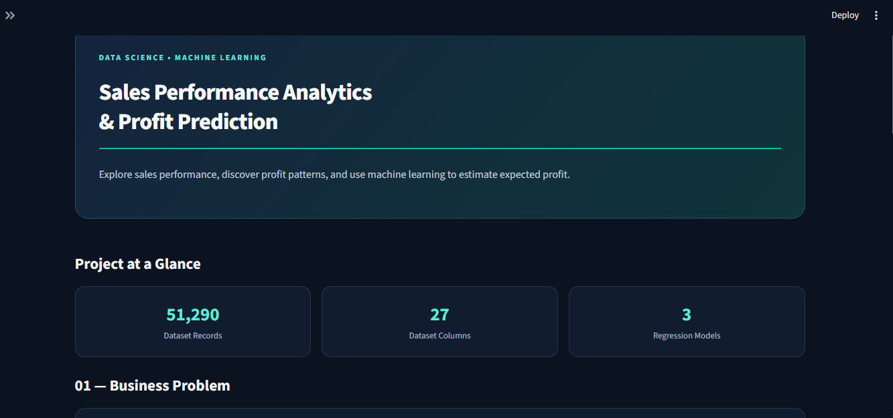
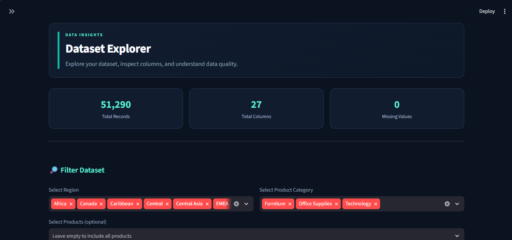
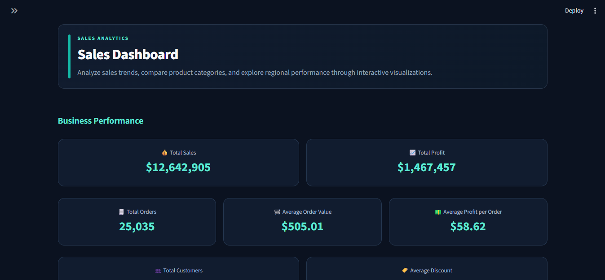
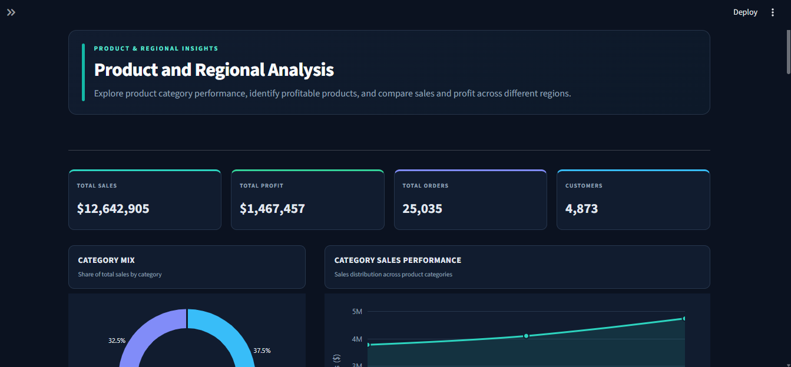
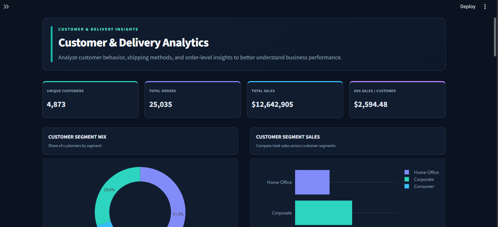
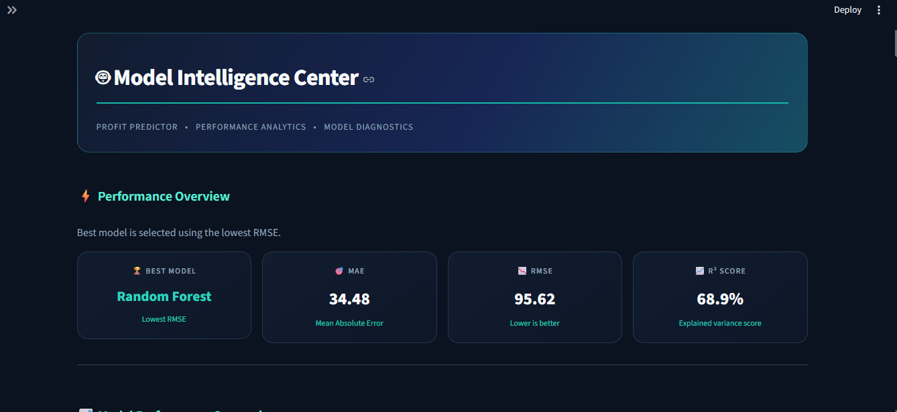
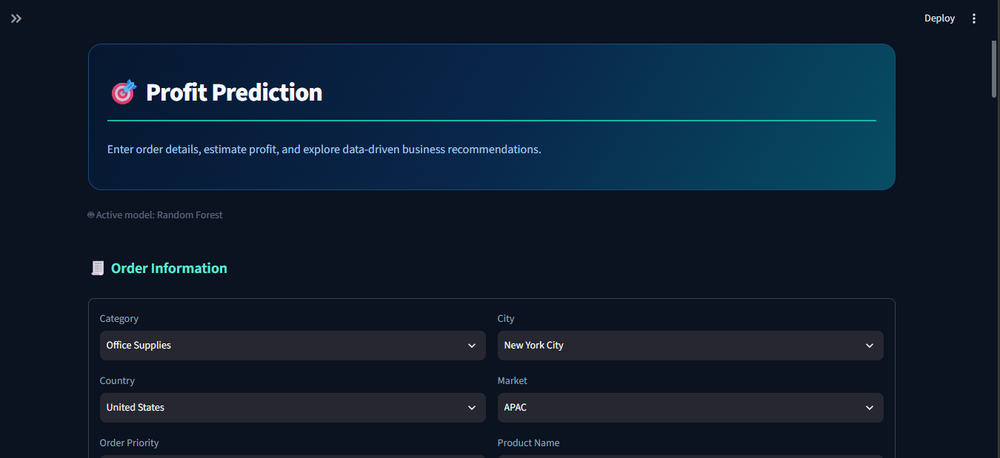

# Profit Predictor – Global Superstore Sales Analytics

## 1. Business Problem
Businesses need to understand their sales and profit performance to make better decisions. Some products may generate high sales but low profit due to discounts, shipping costs, or other factors. This project analyzes Global Superstore data and uses machine learning to predict profit and support business decision-making.

## 2. Project Objectives
- Analyze sales and profit patterns.
- Identify high-performing and low-performing product categories.
- Explore regional and customer-related performance.
- Perform data cleaning and exploratory data analysis (EDA).
- Train and evaluate machine-learning models for profit prediction.
- Develop an interactive Streamlit application.
- Provide data-driven business recommendations.

## 3. Dataset Description
The project uses the Global Superstore dataset.

- **Rows:** 51,290
- **Original columns:** 27
- **Important columns:** Sales, Profit, Discount, Quantity, Category, Sub-Category, Region, City, Segment, Shipping Cost, and Order Priority.
- **Dataset source:** TODO – Add your dataset source URL.

The dataset contains information about sales transactions, products, customers, regions, discounts, shipping, and profit.

## 4. Tools and Technologies
- Python
- Pandas
- NumPy
- Matplotlib
- Seaborn
- Scikit-learn
- Joblib
- Jupyter Notebook
- Streamlit

## 5. Data-Cleaning Steps
The following checks were performed during data preparation:

- Checked missing values.
- Checked duplicate records.
- Verified numerical and categorical data types.
- Investigated unusual and negative profit values.
- Checked discount values and their representation.
- Reviewed date-column quality.
- Prepared the data for exploratory analysis and machine learning.

**Note:** Only report cleaning operations that were actually performed. Explain any unresolved date-column issues if they remain in the final dataset.

## 6. Exploratory Data Analysis (EDA)
EDA was performed to understand the dataset and identify business patterns.

The analysis includes:
- Sales and profit summaries.
- Category-wise sales and profit.
- Regional performance.
- Product and sub-category analysis.
- Customer-segment analysis.
- Discount and profit relationships.
- Sales trends and business visualizations.

### Key Findings

- The dataset contains **51,290 records and 27 columns**.
- **Office Supplies** is the most frequent category, with 31,273 records.
- The **Consumer** segment has the highest number of records, with 26,518.
- The **Central** region has the highest number of records, with 11,117.
- The dataset contains both positive and negative profit values, indicating that some sales transactions result in losses.
- Data quality checks found **no missing values and no duplicate records**.
- The Random Forest model achieved an **R² score of 0.689**, with an MAE of 34.481 and RMSE of 95.616.

## 7. Machine-Learning Models
Machine-learning models were trained to predict the Profit target using selected transaction features.

**Models trained:** 
-Linear Regression
-Decision Tree
-Random Forest

The models were evaluated using:
- Mean Absolute Error (MAE)
- Root Mean Squared Error (RMSE)
- R-squared (R²)

## 8. Model Evaluation Results

| Model | MAE | RMSE | R² |
|---|---:|---:|---:|
| Random Forest | 34.481 | 95.616 | 0.689 |
| Decision Tree | 38.562 | 115094.568 | 107.258 | 0.608
| Linear Regression | 43.081 | 15880.039 | 126.016 | 0.460


## 9. Best Model
The best-performing model is selected by comparing the evaluation results, particularly RMSE, MAE, and R².

**Selected model:** Random Forest

The selected model is used by the Streamlit application to generate profit predictions for user-provided inputs.

## 10. Streamlit Application Features
The application provides an interactive interface with the following pages:

- Home / Dashboard
- Dataset Explorer
- Sales Dashboard
- Product & Regional Analysis
- Customer & Delivery Analysis
- Model Evaluation
- Profit Prediction

Users can explore data, view visualizations, review model performance, and generate profit predictions.

## 11. Business Recommendations
Recommendations should be based on findings from the dataset.

Potential areas for investigation include:
- Review high-discount transactions with low or negative profit.
- Investigate products that generate high sales but low profit.
- Compare profitability across regions and product categories.
- Review shipping costs alongside profit performance.
- Use model predictions as decision-support estimates, not guaranteed outcomes.

## 12. Project Structure
```text
Profit_Predictor/
├── app.py
├── requirements.txt
├── README.md
├── .gitignore
├── data/
│   └── Global Superstore.csv
├── notebooks/
│   └── profit_predictor.ipynb
    ├── models/
     └── trained_models.joblib
     ├── encoder.joblib
     ├── test_data.joblib
     └── feature_info.joblib


```


## 13. Local Installation

### Requirements
Python and the packages listed in `requirements.txt`.

### Installation Steps
1. Clone the repository:
   ```bash
   git clone YOUR_GITHUB_REPOSITORY_URL
   ```

2. Open the project directory:
   ```bash
   cd Profit_Predictor
   ```

3. Install dependencies:
   ```bash
   pip install -r requirements.txt
   ```

4. Run the Streamlit application:
   ```bash
   streamlit run app.py
   ```

5. Open the local URL displayed in the terminal.

Ensure the dataset and required model files are available at the paths expected by the application.

## 14. Streamlit Deployment
**Live application:** TODO – Add your Streamlit Community Cloud URL after deployment.

## 15. Application Screenshots

### home


### dataset_explorer


### Sales Dashboard


### project_and_regional_analysis


### customer_and_delivery_analytics


### model_intelligence_center


### profit_prediction


Save the screenshots in the `screenshots` folder using the exact filenames shown above, or update the image paths accordingly.

## 16. Project Deliverables
- Complete Python source code.
- Jupyter Notebook containing data analysis and model development.
- Trained machine-learning model files.
- Streamlit